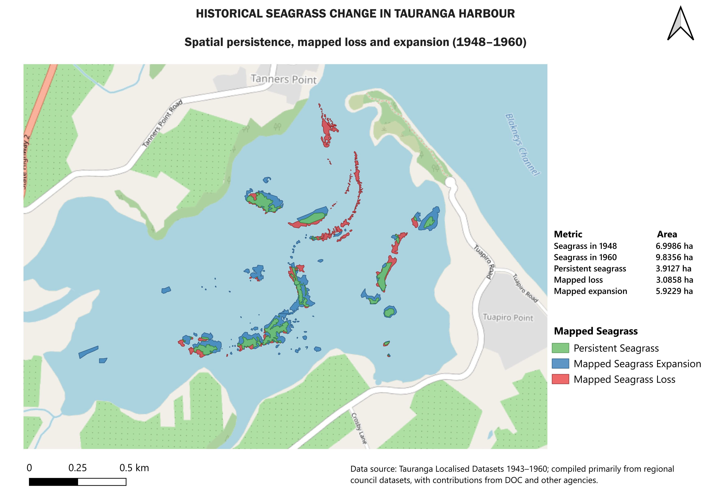

# Historical Seagrass Change in Tauranga Harbour, New Zealand (1948–1960)

## Project Overview

This project investigates historical changes in mapped seagrass extent in Tauranga Harbour, New Zealand, between 1948 and 1960.

Using historical seagrass habitat datasets and GIS-based spatial analysis, the project examines the spatial distribution of persistent seagrass, mapped loss, and mapped expansion between the two survey periods.

The analysis was conducted using QGIS, with the aim of understanding historical habitat patterns and demonstrating how geospatial techniques can support coastal habitat assessment.

## Research Questions

- How did the mapped extent of seagrass change between 1948 and 1960?
- Which areas showed spatial persistence between the two survey periods?
- Where did mapped seagrass loss and expansion occur?

## Study Area

**Tauranga Harbour, Bay of Plenty, New Zealand**

The analysis focuses on mapped seagrass habitat within Tauranga Harbour, including areas around the harbour's estuarine environments.

## Data Sources

The historical habitat data were obtained from the **Tauranga Localised Datasets 1943–1960** service.

The dataset documentation states that the layer was compiled primarily from regional council datasets, with contributions from DOC and other agencies.

- **Data provider:** New Zealand Department of Conservation (DOC), SeaSketch
- **Dataset:** Tauranga Localised Datasets 1943–1960
- **Habitat:** Seagrass (*Zostera muelleri*)
- **Survey years analysed:** 1948 and 1960
- **Coordinate Reference System:** NZTM2000 (EPSG:2193)
- **Original data source:** [DOC SeaSketch – Tauranga Localised Datasets 1943–1960](https://seasketch.doc.govt.nz/arcgis/rest/services/National/Tauranga_Localised_Datasets_1943_to_1960/MapServer)

## Methodology

The project workflow included:

1. Acquisition of historical seagrass spatial data.
2. Inspection and preparation of the spatial datasets.
3. Reprojection to NZTM2000 (EPSG:2193).
4. Separation of the 1948 and 1960 survey records.
5. Geometry validation and correction using the QGIS Fix Geometries tool.
6. Spatial intersection to identify areas mapped in both survey periods (persistent mapped seagrass).
7. Difference analysis to identify mapped loss (1948 minus 1960) and mapped expansion (1960 minus 1948).
8. Calculation of polygon areas in hectares.
9. Calculation of spatial persistence percentages and area statistics.
10. Preparation of the final change-detection map using QGIS.

## Results

| Metric | Area |
|---|---:|
| Mapped seagrass in 1948 | 6.9986 ha |
| Mapped seagrass in 1960 | 9.8356 ha |
| Spatially persistent area | 3.9127 ha |
| Mapped loss | 3.0858 ha |
| Mapped expansion | 5.9229 ha |

### Spatial Persistence

- Approximately 55.9% of the 1948 mapped area overlapped with the 1960 mapped extent.
- Approximately 39.8% of the 1960 mapped area overlapped with the 1948 mapped extent.

These percentages describe spatial overlap between the two mapped survey periods. They do not establish continuous ecological survival between surveys.

## Map Output

The following map illustrates the spatial distribution of persistent seagrass, mapped expansion, and mapped loss between 1948 and 1960.

*Figure 1. Historical seagrass extent change in Tauranga Harbour, New Zealand (1948–1960).*

## Limitations

- Historical survey methods and mapping accuracy may differ between survey periods.
- Spatial overlap does not necessarily indicate continuous habitat survival.
- The results describe changes in mapped extent and should not automatically be interpreted as definitive ecological gain or loss.

## Tools and Technologies

- QGIS
- Spatial overlay analysis
- Geometry validation
- Coordinate reference systems and reprojection
- Area calculations and spatial statistics

## Project Files and Reproducibility

The repository contains the QGIS project, processed spatial datasets, analysis outputs and technical documentation.

### Repository Structure

| Folder/File | Description |
|---|---|
| `project/` | QGIS project file (.qgz) |
| `data/processed/` | Processed GeoPackage datasets |
| `methods/` | GIS methodology and processing workflow |
| `results/` | Spatial analysis results and statistics |
| `report/` | Technical report in Markdown and PDF formats |
| `Tauranga_Seagrass_Change_1948_1960.png` | Final change-detection map |

### How to Reproduce the Analysis

1. Download or clone this repository.
2. Open the QGIS project located in `project/`.
3. Ensure the supporting GeoPackage datasets are available in `data/processed/`.
4. Review the methodology documentation in `methods/`.
5. Explore the spatial outputs and statistics in `results/`.

**Software:** QGIS  
**Coordinate Reference System:** NZTM2000 (EPSG:2193)  
**Spatial Data Format:** GeoPackage (.gpkg)

## Author

Ricky

This project is part of an ongoing effort to develop practical skills in GIS, spatial analysis, and coastal habitat assessment.
