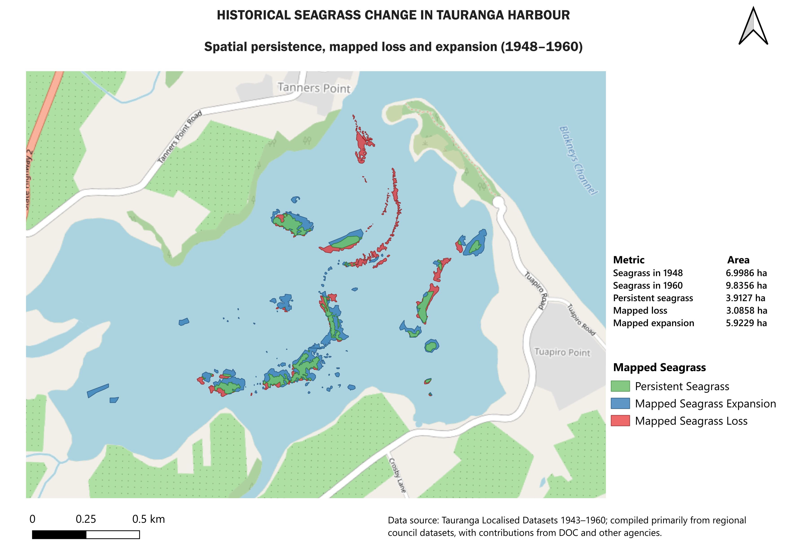

# Historical Seagrass Change in Tauranga Harbour, New Zealand (1948–1960)

**A GIS-based assessment of mapped seagrass persistence, loss and expansion**

**Author:** Ricky  
**Study area:** Tauranga Harbour, Bay of Plenty, New Zealand  
**Study period:** 1948–1960  
**Software:** QGIS  
**Coordinate Reference System:** NZTM2000 (EPSG:2193)

---

## Abstract

Seagrass habitats are important components of coastal and estuarine ecosystems. Understanding changes in their spatial distribution can contribute to habitat monitoring and coastal management. This study examines historical changes in mapped seagrass extent in Tauranga Harbour, Bay of Plenty, New Zealand, between 1948 and 1960 using Geographic Information Systems (GIS).

Historical seagrass habitat polygons were obtained from the Tauranga Localised Datasets 1943–1960, provided through the New Zealand Department of Conservation (DOC). The 1948 and 1960 survey records were extracted and processed in QGIS. The workflow included geometry validation, area calculation, spatial intersection and classification of mapped habitat into persistent seagrass, mapped loss and mapped expansion.

The mapped seagrass area increased from 6.9986 hectares in 1948 to 9.8356 hectares in 1960. The spatially overlapping area was 3.9127 hectares. This represented approximately 55.9% of the 1948 mapped extent and 39.8% of the 1960 mapped extent. Mapped loss accounted for 3.0858 hectares, while mapped expansion accounted for 5.9229 hectares.

The results demonstrate changes in the spatial distribution of mapped seagrass habitat between the two historical survey periods. However, differences in historical survey methods, mapping accuracy and spatial coverage must be considered. The results describe changes in mapped extent and should not automatically be interpreted as definitive ecological gain or loss.

## 1. Introduction

Seagrass habitats provide important ecological functions in coastal and estuarine environments. They contribute to habitat complexity, support marine biodiversity, provide nursery and feeding grounds for marine organisms, and interact with coastal sediment processes.

Monitoring changes in seagrass distribution is therefore relevant to understanding coastal habitat dynamics and supporting environmental management.

Historical habitat datasets provide an opportunity to examine how the mapped distribution of coastal ecosystems has changed over time. However, comparing historical spatial datasets requires careful consideration of differences in survey methods, mapping accuracy, data coverage and spatial representation.

Geographic Information Systems (GIS) provide tools for processing spatial datasets, calculating habitat areas and identifying spatial relationships between different survey periods.

This project uses historical seagrass mapping data from Tauranga Harbour to examine changes in mapped seagrass extent between 1948 and 1960.

### 1.1 Aim

To assess changes in the spatial distribution of mapped seagrass habitat in Tauranga Harbour between 1948 and 1960 using GIS-based spatial analysis.

### 1.2 Objectives

The specific objectives were to:

1. Acquire and prepare historical seagrass spatial datasets.
2. Extract the 1948 and 1960 survey records for comparison.
3. Validate polygon geometries and calculate mapped habitat areas.
4. Identify spatially overlapping seagrass habitat between the two survey periods.
5. Calculate mapped persistence, loss and expansion areas.
6. Visualise the spatial distribution of these changes through a GIS map.

### 1.3 Research Questions

- How did the mapped seagrass area differ between 1948 and 1960?
- What proportion of the mapped habitat overlapped between the two survey periods?
- Where were mapped persistence, loss and expansion distributed within the study area?

## 2. Study Area

The study focuses on Tauranga Harbour, located in the Bay of Plenty region of New Zealand.

The analysis uses historical seagrass habitat polygons associated with Tauranga Harbour. The mapped features represent seagrass distribution recorded during historical survey periods.

The study area was selected because the available historical dataset contains seagrass records from multiple survey years, allowing a spatial comparison of mapped habitat extent.

**Study area:** Tauranga Harbour, Bay of Plenty, New Zealand.

## 3. Data Sources

### 3.1 Primary Dataset

The primary dataset used in this analysis was the *Tauranga Localised Datasets 1943–1960*.

- **Provider:** New Zealand Department of Conservation (DOC)
- **Original compilation:** Primarily regional council datasets, with contributions from DOC and other agencies.
- **Data type:** Historical seagrass habitat polygons.
- **Survey years available:** 1943, 1948 and 1960.
- **Habitat:** Seagrass (*Zostera muelleri*), also identified as eelgrass in the dataset.

The dataset documentation describes the wider objective of compiling a comprehensive spatial and temporal habitat layer using information from regional councils, DOC and other agencies.

### 3.2 Survey Periods Selected

Although the dataset contains three historical survey years, the primary change analysis in this project compares 1948 and 1960.

The 1948 and 1960 records were extracted into separate vector layers to enable spatial overlay analysis.

### 3.3 Coordinate Reference System

All spatial analysis was conducted using:

**NZTM2000 — EPSG:2193**

The projected coordinate reference system was used for spatial processing and area calculations in hectares.

## 4. Methodology

The analysis was conducted in QGIS using vector processing and spatial overlay tools.

### 4.1 Data Preparation

The historical seagrass dataset was added to QGIS.

Individual survey years were extracted using the `Date` attribute. Separate vector layers were created for the 1948 and 1960 records.

The extracted datasets were saved as individual GeoPackage layers for subsequent processing.

### 4.2 Geometry Validation

Before conducting spatial overlay operations, the extracted polygon layers were inspected for invalid geometries.

Invalid polygon geometries can interfere with spatial operations such as intersection.

The QGIS Fix Geometries processing tool was used to correct geometry errors. The corrected datasets were saved as separate layers and used for subsequent analysis.

### 4.3 Area Calculation

The area of each seagrass polygon was calculated using the projected NZTM2000 coordinate reference system.

A dedicated field, `Area_ha_calc`, was used to store polygon area measurements in hectares.

The calculated areas were aggregated to obtain the total mapped seagrass area for each survey year.

### 4.4 Spatial Intersection

The QGIS Intersection tool was used to identify the spatial overlap between the 1948 and 1960 seagrass polygons.

The resulting intersection layer represents the areas where mapped seagrass polygons from both survey periods spatially overlap.

The area of the intersection was calculated to estimate the spatially persistent mapped habitat.

### 4.5 Classification of Spatial Change

The mapped habitat was classified into three categories.

**Persistent mapped seagrass**

Areas mapped in both 1948 and 1960.

**Mapped seagrass loss**

Areas mapped in 1948 but not included in the 1960 mapped extent.

**Mapped seagrass expansion**

Areas mapped in 1960 but not included in the 1948 mapped extent.

These categories describe spatial differences between the two survey datasets.

### 4.6 Statistical Analysis

Area statistics were calculated for the original survey layers and the derived spatial-change layers.

Two persistence percentages were calculated to describe the proportion of each survey year's mapped extent that overlapped with the other survey period.

The formulas used were:

**Persistence relative to 1948:**

Persistence (1948) = (Overlap area / Total mapped area in 1948) × 100

**Overlap relative to 1960:**

Persistence (1960) = (Overlap area / Total mapped area in 1960) × 100

These measurements describe spatial overlap and do not establish continuous ecological survival between survey dates.

### 4.7 Map Production

A QGIS print layout was prepared to communicate the spatial distribution of mapped seagrass persistence, loss and expansion.

The final map includes:

- Study title and survey period.
- Spatial distribution of the three mapped-change categories.
- Legend.
- North arrow.
- Scale bar.
- Area statistics.
- Data source information.
- Coordinate reference system.

## 5. Results

### 5.1 Mapped Seagrass Area

The total mapped seagrass area differed between the two survey periods.

| Metric | Area (ha) |
|---|---:|
| Mapped seagrass in 1948 | 6.9986 |
| Mapped seagrass in 1960 | 9.8356 |
| Persistent mapped area | 3.9127 |
| Mapped loss | 3.0858 |
| Mapped expansion | 5.9229 |

The mapped area increased by approximately 2.8370 hectares between 1948 and 1960.

This represents an increase in the total mapped extent, rather than confirmation of an equivalent ecological increase in seagrass abundance or health.

### 5.2 Spatial Persistence

The spatial intersection identified approximately 3.9127 hectares of overlapping mapped habitat.

Relative to the 1948 mapped extent:

\[
\frac{3.9127}{6.9986}\times100 \approx 55.9\%
\]

Approximately 55.9% of the 1948 mapped area overlapped with the 1960 mapped extent.

Relative to the 1960 mapped extent:

\[
\frac{3.9127}{9.8356}\times100 \approx 39.8\%
\]

Approximately 39.8% of the 1960 mapped area overlapped with the 1948 mapped extent.

These percentages demonstrate that the spatial overlap represents different proportions of the two survey periods because their total mapped areas differ.

### 5.3 Mapped Loss and Expansion

The analysis identified:

- **Mapped loss:** 3.0858 hectares.
- **Mapped expansion:** 5.9229 hectares.

Mapped loss represents areas included in the 1948 extent but not in the 1960 extent.

Mapped expansion represents areas included in the 1960 extent but not in the 1948 extent.

The larger mapped expansion area contributed to the higher total mapped seagrass extent recorded in 1960.

### 5.4 Spatial Distribution

The final map illustrates the spatial distribution of persistent mapped seagrass, mapped loss and mapped expansion across Tauranga Harbour.

The results show that spatial overlap was not uniform across the study area. Some mapped habitat areas overlapped between the two survey periods, while other areas were represented in only one of the survey datasets.

**Figure 1.** Historical seagrass extent change in Tauranga Harbour, New Zealand (1948–1960). The map displays persistent mapped seagrass, mapped expansion and mapped loss.

## 6. Discussion

### 6.1 Changes in Mapped Seagrass Extent

The analysis indicates that the total mapped seagrass area increased from approximately 6.9986 hectares in 1948 to 9.8356 hectares in 1960.

However, the total area alone does not explain the spatial changes occurring between the two survey periods.

The intersection analysis provides additional information by identifying areas that were mapped in both periods. Approximately 3.9127 hectares overlapped, while other areas were classified as mapped loss or expansion.

This demonstrates the importance of examining spatial distribution rather than relying exclusively on total area comparisons.

### 6.2 Understanding Spatial Persistence

The two persistence percentages provide complementary perspectives.

The 55.9% overlap relative to 1948 indicates that slightly more than half of the earlier mapped extent was also represented in the later dataset.

The 39.8% overlap relative to 1960 indicates that a smaller proportion of the later mapped extent overlapped with the earlier dataset.

The difference between these percentages is expected because the total mapped area differed between the two survey periods.

Importantly, spatial overlap should not be interpreted as proof that the same seagrass plants or continuous habitat persisted throughout the twelve-year interval. It indicates that the mapped polygons overlap spatially.

### 6.3 Significance for Historical Habitat Mapping

Historical spatial datasets can provide useful baseline information for examining long-term changes in coastal habitats.

GIS-based overlay analysis makes it possible to compare historical habitat distributions, quantify mapped area differences and identify locations where mapped extents overlap or differ.

This approach can support further investigation into coastal habitat change, provided that the limitations of historical data are recognised.

## 7. Limitations

Several limitations should be considered when interpreting the results.

1. **Historical survey differences:** Survey methods and mapping techniques may have differed between 1948 and 1960.

2. **Spatial accuracy:** Historical polygon boundaries may not have the same positional accuracy as modern spatial datasets.

3. **Data coverage:** Differences in survey coverage may influence the mapped extent recorded for each period.

4. **Interpretation of overlap:** Spatial intersection identifies overlapping mapped areas but does not establish continuous ecological survival between survey dates.

5. **Ecological condition:** The analysis examines mapped spatial extent and does not directly measure seagrass density, biomass, health or ecological condition.

Consequently, mapped loss and expansion should not automatically be interpreted as definitive ecological degradation or recovery.

## 8. Conclusion

This study used GIS-based spatial analysis to examine historical changes in mapped seagrass extent in Tauranga Harbour between 1948 and 1960.

The mapped seagrass area increased from 6.9986 hectares in 1948 to 9.8356 hectares in 1960. Spatial intersection identified approximately 3.9127 hectares of overlapping mapped habitat, equivalent to 55.9% of the 1948 mapped extent and 39.8% of the 1960 mapped extent.

The analysis also identified 3.0858 hectares of mapped loss and 5.9229 hectares of mapped expansion.

The results demonstrate that changes in total mapped area and spatial distribution provide different but complementary information about historical habitat patterns.

The project demonstrates the application of QGIS for historical habitat data preparation, geometry validation, area calculation, spatial overlay analysis and cartographic communication.

Future work could incorporate additional historical and contemporary habitat datasets, higher-resolution remote sensing products and environmental variables to investigate the factors associated with observed changes in mapped seagrass distribution.

## 9. References

Department of Conservation, New Zealand. *Tauranga Localised Datasets 1943–1960*. Historical seagrass habitat dataset, compiled primarily from regional council datasets with contributions from DOC and other agencies.

**Coordinate reference system:** New Zealand Transverse Mercator 2000 (NZTM2000), EPSG:2193.

**Software:** QGIS.

## 10. Reproducibility and Project Resources

The project repository contains supporting documentation, spatial analysis results and the final map.

The analysis was conducted using QGIS and the historical seagrass polygon dataset described above.

Project repository: [Insert GitHub repository URL]

### Project Components

- `data/` — Dataset documentation and source information.
- `methods/` — GIS processing methodology.
- `results/` — Area statistics and spatial analysis results.
- `report/` — Technical report.
- `README.md` — Project overview and summary.

The project aims to provide a transparent record of the GIS workflow and its findings while recognising the limitations of historical spatial data.
